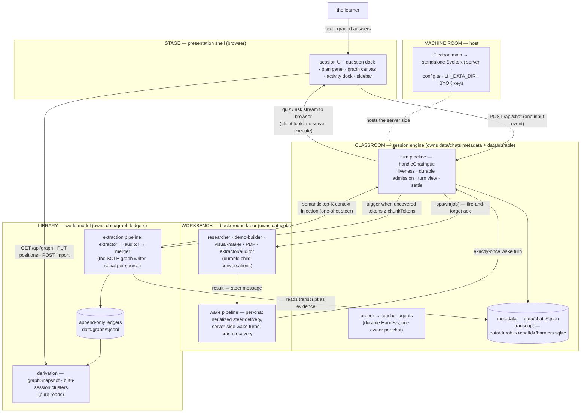

# Development guide

The developer README (split out of the storefront README, 2026-10-10). Everything below is for people working ON LearnHarness, not using it.

A standalone learning app (web + Electron desktop): a **teacher agent** (SvelteKit + adapter-node; an app-owned input-event and turn-event SSE protocol, a durable [pi-durable](https://www.npmjs.com/package/@earendil-works/pi-durable) Harness with one SQLite database per chat, LLM engine [pi-ai](pi-engine-swap.md) via OpenRouter), probe→teach lessons with graded quiz/ask interactions, a formal **session plan tree** the teacher authors once (`plan_init`) and whose progress is derived from tagged quiz calls, and a persistent cross-session **knowledge graph** of what the learner knows — the graph is the app's home page.

Not a chat app with a graph bolted on: sessions are probe→teach lessons, the plan tree is a structured, schema-validated object, sessions accumulate into the graph through the extraction pipeline (propositions + reasoning chains — the stored truth; the canvas renders a derived image), and the teacher reaches back into the graph through read-only prober tools on its own judgment so probing compounds across sessions.

- [`docs/architecture.md`](architecture.md) is the **canonical architecture spec** — layers, the import law, the five systems, the invariants, the seam directory. (The pre-audit spec is archived under `docs/archive/` — history only.)
- Living design doc (all decisions): [`docs/vision.md`](vision.md)
- Build plan + wave/gate results: [`docs/plan.md`](plan.md)

## Commands

```bash
npm install          # once

npm run dev          # http://localhost:3000
npm run build        # SvelteKit adapter-node build (dist-server/)
npm start            # load source env, curate the payload, then serve

node scripts/build-server.mjs   # curate dist-server/standalone from the adapter output
node scripts/smoke-server.mjs   # boot the isolated payload (--electron uses the packaged runtime)
node scripts/smoke-carrier.mjs  # SSR, routing, CSRF, SSE and assets over real HTTP

npm test             # deterministic suite (node:test via tsx; no LLM or network)
npm run lint         # eslint — includes the import law (architecture §2)
npm run typecheck    # svelte-kit sync + tsc --noEmit + svelte-check

npm run desktop:dev    # vite dev + Electron shell pointed at it
npm run desktop:dist   # local signed/notarized macOS arm64 build (LH_NOTARY keychain)

# one-shot data scripts (run from the master tree only — data never crosses trees)
npx tsx --env-file=.env.local scripts/import-notes.ts <dir>   # bulk-import notes → graph
npx tsx --env-file=.env.local scripts/backfill-graph.ts       # wipe + re-extract every chat
npx tsx --env-file=.env.local scripts/replay-layout.ts        # re-derive layout from the ledgers
npx tsx scripts/sync-pricing.ts                               # regenerate core/prices.ts tables
```

For Windows/Linux packages and the three-OS CI/release flow, see [`desktop-release.md`](desktop-release.md). Native renderer binaries are installed per platform, so release builds run on the target OS, not as cross-builds from macOS.

## Browser verification

Browser checks require a separately installed `agent-browser` CLI and its browser. The migration was tested with CLI 0.38.1. These checks remain separate from CI and `npm test`, by explicit choice. They use copies of the checked-in fixtures, disposable data and auth, loopback scripted providers, and labelled API or preload fixtures. They do not call a real model.

```bash
npm run build
node scripts/build-server.mjs
npm run test:browser
```

The command runs 39 interaction checks and the optimistic-message regression. Each run copies the payload before boot. Results and screenshots go to a temporary run directory printed by the script. See the [migration record](frontend-migration.md), [test-file mapping](frontend-test-port.tsv), and [interaction contracts](frontend-interaction-coverage.tsv).

## Environment (`.env.local`)

Source commands load environment files with Vite priority. Existing shell values win, including empty values. Then `.env.[mode].local`, `.env.[mode]`, `.env.local`, and `.env` apply in decreasing priority. Mode files outrank `.env.local`, unlike Next.js. Values support Vite's variable expansion. The packaged app does not load dotenv files.

Secrets and machine-specific paths only. Model choice and thinking budgets are the user's, not the environment's — BYOK model slots live in **settings** (`models` section: strong/cheap/vision, provider + model id + optional thinking level; per-role and per-chat overrides ride on top). The extraction batch threshold is a settings knob too (`graph.extractionChunkTokens`, default 4096, floor 500).

| Variable | Purpose |
|---|---|
| Provider key (`OPENROUTER_API_KEY`, `ANTHROPIC_API_KEY`, ...) | required — the key for the provider chosen in the model slots; `GET /api/keys` lists the supported provider variables |
| `TAVILY_API_KEY` or `BRAVE_API_KEY` | researcher's `web_search` (set one; the settings pin the engine) |
| `DEEPGRAM_API_KEY` | optional — dictation (STT token minting; audio streams browser→Deepgram, never through the server) |
| `CHROME_PATH` | optional system Chrome fallback for demo verification; the app's own browser helper is primary (nothing is downloaded) |
| `LH_ROOT` | packaged builds only — the payload root holding the read-only prompt assets; the launcher sets it |
| `LH_DATA_DIR` | relocates chats, durable stores, graph and settings; the desktop shell points it at `userData/data` |
| `LH_AUTH_FILE` | path to the BYOK key file; the desktop shell points it at `userData/auth.json` |

The packaged desktop app takes keys from `userData/auth.json` (BYOK, mode 0600, read/written directly by the server via `LH_AUTH_FILE`). PDFs render natively with pdfjs/Skia; SVGs use resvg.

Source `npm start` keeps data in the repository's `data/` and `auth.json` unless you set nonempty path overrides. It does not store records inside `dist-server/`. If a build or curation reports existing mutable files inside the payload, stop and back them up. Move them to the intended data and auth locations before rebuilding. The builder will not delete them for you.

## Architecture

Five layers, dependency arrows pointing inward only, enforced by ESLint (shell → barrels only; core and agent never import below themselves). Two composition roots, one writer per store. The full spec — layers, systems, runtime flows, invariants, seams: [`docs/architecture.md`](architecture.md).



**Core invariant:** the extraction pipeline (extractor → auditor → merger) is the sole graph writer — tree-blind and post-hoc, triggered by token coverage, not quiz counts. The LLM stages propose, verify, and judge identity (link-or-create against the current graph; each finding carries verbatim evidence and message-granular provenance); the deterministic merger owns every ledger append (ids, provenance, chain dedupe — the same argument re-asserted merges under one `arg_` id). Every node is an objective, world-facing fact; the learner's relationship to it lives entirely in practice sessions — feedback-only, never written back. The teacher stays a teacher; everything below the ledgers is derived.

## Layout

```
src/routes/                     SvelteKit file-based transport and pages
  api/                          32 +server.ts endpoint files (40 methods)
  +page.server.ts               SSR loads — the same props the former pages passed
  +page.svelte                  page shells: home · chat · new session
  +layout.svelte                root shell (the one EventSource mount)
src/lib/                        Svelte render layer, grouped by responsibility
  chat/                         session UI · question dock · composer · plan panel
  home/                         graph view · chain table · session picker
  settings/                     settings and setup dialogs
  shell/                        sidebar · activity dock · update banner
  artifacts/                    job and artifact renderers
  markdown/                     markdown · code · math · mermaid
  state/                        client stores and the server-events listener
  ui/                           shared primitives
  chat/session-core.ts          framework-free session state machine
  home/graph-canvas.ts          shared Canvas 2D renderer
src/
  agent/
    system-prompt.md            base teaching behavior (the methodology)
    prompts/{prober,teacher,practice}/
                                composed numbered fragments per role
    teacher-agent.ts            prober/teacher factories (engine injectable for tests)
    tools.ts                    tool composition; quiz / ask_user_question (client tools)
    tools/plan.ts               plan_init (author-once mermaid plan, deterministic parser)
    tools/probe.ts              probe_done (probe→teach handoff seam)
    tools/jobs.ts               research / demo / visual tool surfaces
    tools/practice.ts           problem / conclude (practice sessions)
    tools/web.ts                web_search (Tavily/Brave) + web_fetch (researcher only)
    subagents/                  researcher · demo-builder · visual-maker
                                · pdf-reader,
                                extraction pipeline (extractor/auditor + merger handoff),
                                runner (async protocol), native renderers + browser-service helper,
                                abort registry
  server/chat-handler.ts       THE turn composition root (liveness · durable admission · recovery · settle)
  server/turn-service.ts       turn seams: answer writes · turn descriptor/settle · plan blocks · usage · extraction trigger
  server/jobs.ts               the wake pipeline: serialized per-chat steer delivery,
                               server-side wake turns, crash recovery
  server/stores.ts              THE storage composition root — the one place adapters wire in
  server/turn-liveness.ts       per-chat turn registry (one turn per chat, ever)
  server/observability.ts       the activity feed (running jobs + extraction, abort)
  server/pi/                    the durable turn view (durable-turn) · tool-call id hygiene (call-ids)
  server/index.ts               the server barrel (the only server import src/routes may use)
  core/contracts/{plan,graph,chat,jobs,probe,models}.ts
                                the contracts — one file per domain
  core/ports.ts                 storage ports — ChatStore · GraphStore · JobStore
                                · SettingsStore · PromptOverrideStore · AuthStore
                                (core code depends on these types only)
  core/                         question-core, plan-tree, phases, pending, graph
                                (merger/derivation), coverage, layout, clusters,
                                prices, tool-parts — all pure: storage
                                arrives as parameters
  store/                        fs adapters implementing the ports: chats · graph
                                ledgers · jobs · settings · auth · prompt overrides
                                (+ render-settings)
electron/                       desktop launcher + security guard (spawns the standalone
                                server; 1 IPC channel; LH_DATA_DIR + BYOK env)
scripts/                        build-server.mjs (packaging guards), import-notes,
                                backfill-graph, replay-layout, sync-pricing
data/                           chats/ (metadata) · durable/ (per-chat SQLite
                                transcript/runs) · graph/ (nodes/chains/sessions/
                                coverage ledgers + positions/sources/render-settings
                                maps) · jobs/ · settings.json — runtime state, git-ignored
```

## Key mechanisms

**Question tools pause the run.** `quiz` and `ask_user_question` execute on the server and commit a placeholder result (`details: null`). The patched afterTools stop ends the run and parks the inbox, so no queued steer starts a model call before the learner answers. The client grades in the dock via `question-core`; the answer replaces the placeholder through a ContextEdit, and the hidden continuation input starts the reaction run. Options are shuffled deterministically (seeded by toolCallId) so server and client renders match. A pending quiz persisted in the transcript is exactly what makes **resume mid-question free**.

**The formal plan tree (author-once).** The teacher authors the session's dependency tree with one schema-validated tool — `plan_init`, whose mermaid-subset input is parsed deterministically (line-numbered errors) and validated as a DAG. The tree persists in the chat record; progress is never mutated — `current`/`visited`/upcoming are **derived** from tagged quiz calls in the transcript, and the panel renders that derivation.

**The async sub-agent protocol (ack-and-steer).** `research` / `demo` / `visual` are server-executed tools: the call resolves immediately mid-turn with a fire-and-forget ack and the teacher keeps teaching; a background runner works in parallel (the client polls `/api/activity` and `/api/jobs`). On completion the runner builds a **steer marker** (an `lh.marker` entry whose model-facing text is the result and whose details carry the artifact) and the **wake pipeline** delivers it. A live turn takes the marker into its durable inbox (`whenBusy: steer`) and places it at the next boundary inside the same run. With no live turn, a per-chat serialized queue waits for the turn to end and no question to be pending, then fires a server-side teacher turn carrying every queued marker. A posed question parks the inbox until the learner answers. Delivery is exactly-once (deterministic steer ids, delivered-flag checks at every claim point); stalled jobs are recovered on read; aborted jobs deliver an abort steer. The client adopts the wake turn through the same `turnInFlight` machinery as returning mid-stream (busy shimmer, composer gate) and renders steers as artifacts — never a bubble. Sub-agents **verify, never one-shot**: the demo-builder executes its HTML in the app's own Chromium browser-service (system Chrome fallback) before delivery; the visual-maker rasterizes each SVG natively and looks at it (vision-capable model — the `vision` slot in settings).

**The knowledge graph (two channels, one writer).** The write channel: the extraction pipeline — extractor (LLM: sees the source — the session's teacher prose or a notes chunk — plus its own source's digest (**THE GRAPH SO FAR**: propositions + chains already extracted from this source, ids verbatim — digest-aware redesign, 2026-09-30 evening: the extractor IS the assembler, referencing existing ids instead of restating, leaning on established conclusions as premises); fully trusted; its deliverable is core ideas + reasoning chains: premises that jointly entail a conclusion, submitted as chains and stored as chains — `chains.jsonl` is the truth, edges a derived view; owner redesign + chains-primary, 2026-09-30) → auditor (LLM, an agentic loop that never sees the source: explores the existing graph through `find` / `list_sessions` / `list_propositions` tools and stamps each proposition with an identity verdict — link to an existing node (equivalence bias: paraphrases merge) or create) → merger (`mergeFindings`, deterministic: applies the verdicts, link-appends phrasings/provenance, resolves and dedupes chains — identical arguments merge under one `arg_` id; then the chain-simplification pass strips provably redundant derivations — prefer-fewest-premises + ancestry-cover — checkpoints coverage) → layout settle. A source's batches run strictly in order (each extractor continues the digest of every earlier merge). No quiz outcomes or understanding assessments live in the graph (2026-09-27 cleanup); practice sessions record outcomes in their own transcript and write nothing back to the graph. Triggered when a chat's **uncovered tokens** (message-view fingerprints, `coverage.jsonl`) cross `graph.extractionChunkTokens` (a settings knob, default 8192, floor 500 — read fresh per turn); failure checkpoints nothing, the next trigger re-runs. The same pipeline serves the **notes front door** (`POST /api/graph/import`: any `*.md`/`*.txt` becomes a source; re-imports are idempotent by path hash). The read channel: `GET /api/graph` derives the snapshot from the ledgers — a pure read (`deriveView` rebuilds the lossy image: each chain an implication node `⟹` with premise→implication→conclusion arrows, so two arguments for one conclusion stay two diamonds); the home view is a hand-rolled Canvas 2D renderer (one rAF loop, dirty-flag idle, d3-zoom camera, zoom-gated labels, cluster hulls) over a d3-force layout, with server-persisted render settings and drag-committed positions. Clusters are **birth-session groupings**: a node joins the cluster of the session that birthed it (a chat, or an imported notes file as a file-kind session), derived at read — no embedding pass, no naming pass. The teacher reaches the graph on its own terms through the gated prober tools (`list_sessions` / `list_propositions`, the `agent.graphTools` setting) — there is no automatic context injection.

**Practice sessions.** A practice session is a `ChatRecord` with `kind: "practice"`, not a separate store or pipeline. `POST /api/chats` accepts the kind, and the turn composes the practice prompt and its `problem`/`conclude` tools instead of the prober/teacher pair. `problem` commits the statement and a hidden model solution, then ends the turn; `conclude` records the outcome, verdict, rung, miss class and retest flag, reveals the committed solution, and frees the composer. One problem is active at a time. Practice sessions share the chat record, durable transcript, model settings, turn stream and events channel. They trigger no extraction and write nothing to the graph.

**Dictation.** Optional speech-to-text: the server mints short-lived Deepgram tokens; audio streams browser→Deepgram over WebSocket, never through the server.

## Testing

All deterministic, no LLM, no network (engines are injected — pi-ai's faux provider scripted per test; `globalThis.fetch` stubbed where transport matters):

1. **Pure core units** — merger (via the real fs adapters, backup-and-restored), derivation, coverage, question grading, plan tree, phases, clusters, layout, tool-parts, prices.
2. **Server flows** — `handleChatRequest` driven end-to-end with scripted engines: persistence, liveness, steer claiming, the wake pipeline (409 retry, quiz deferral, idempotency), crash recovery, the data-dir seam (including a fresh child process).
3. **Sub-agent loops** — researcher/demo-builder/visual-maker with fake headless APIs; the extraction pipeline end-to-end (audit drops, failure-checkpoints-nothing, single-flight, abort).
4. **Render and interaction tests** — transcript, cards, docks, composer, sidebar, coverage and graph surfaces, asserted through visible output and user actions on the same view-model contracts.
5. **Golden fixtures** (`tests/fixtures/golden-data/`) — a REAL data dir (real records produced by the app, never hand-edited), copied to a temp dir and read through the production paths via the `LH_DATA_DIR` seam. Pins that real data parses, flattens to a legal LLM wire, derives the graph end-to-end, covers every custom-marker kind, and that reads never write. **The fixture law:** an intentional on-disk format change updates the fixtures in the same commit — see the fixture README.

## Lineage

The teaching methodology comes from an Obsidian-based POC (its `knowledge graph design.md` was the original epistemic-model source, since amended — see the amendments table in `docs/vision.md`). The harness was originally built on the pi agent SDK, pivoted to standalone Next.js + the Vercel AI SDK, later swapped its LLM engine back to pi-ai ([`docs/pi-engine-swap.md`](pi-engine-swap.md)), moved the conversation runtime to pi-durable with an app-owned input-event and turn-event SSE protocol, and then moved the transport and render layer to SvelteKit with adapter-node and SSR.

## Data

Chat metadata, graph ledgers, jobs, positions, and settings use JSON or JSONL. Durable transcripts and run state live in `data/durable/<chatId>/harness.sqlite`. Back up the entire data directory, including SQLite WAL/SHM files and legacy backups, not just the JSON files. The desktop app relocates this directory through `LH_DATA_DIR`. The Python readers in `skills/learnharness/scripts/` use the same records. This frontend migration does not change their formats.

**Schema stamps:** chat metadata carries `version: 2` (stamped at the store's write choke point; absence reads as v1, the legacy shape). The graph family (ledgers, sources, render-settings) shares one sidecar `graph/format.json`, created on the family's first write. `positions.json` is deliberately unstamped (rebuildable). A record stamped NEWER than the running build is refused on read: a read-modify-write store never rewrites what it doesn't understand (the honest downgrade refusal).

**The durable runtime.** Each public chat owns `data/durable/<chatId>/harness.sqlite` (transcript, live runs, background children) plus SQLite's journals/WAL while a run is active. One Harness owns a database per process; close it before deleting a session and never open one chat from two processes. `data/chats/<id>.json` is metadata only. A legacy schema-1 record is imported on first access: the original file is copied byte-for-byte to `data/durable/<chatId>/legacy-chat.json` before the messages become durable entries, and the backup is never deleted automatically. The import queue is process-global so two module instances cannot import twice.

**Backups and upgrades.** Back up the whole `data/` folder while the app is closed, or at least `data/chats/`, `data/durable/`, `data/graph/`, `data/jobs/`, and `data/settings.json`. Metadata alone loses the transcript. `scripts/patch-pi-durable.mjs` patches the exact `@earendil-works/pi-durable@1.4.0` install for the question stop, the input park, and the hook's entry read; it refuses another version or unknown source and is idempotent. `npm ci` applies it through `postinstall`, and a test fails when the patch is absent.
